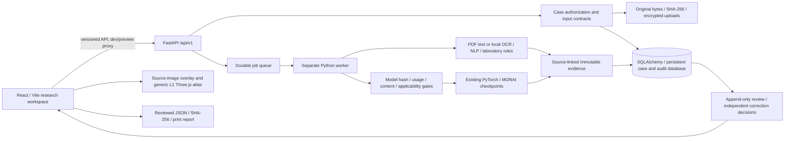

# MedTwin measured architecture

The inspected checkout has a FastAPI service and Vite API proxy; no separate Node API gateway was identified. The executed QA workflows use local SQLite and encrypted uploads, not a live Supabase/PostgreSQL deployment. Supabase client/deployment support exists but was not provisioned or independently verified here. Atlas association remains generic L1; source-image masks do not create patient-specific atlas coordinates.
