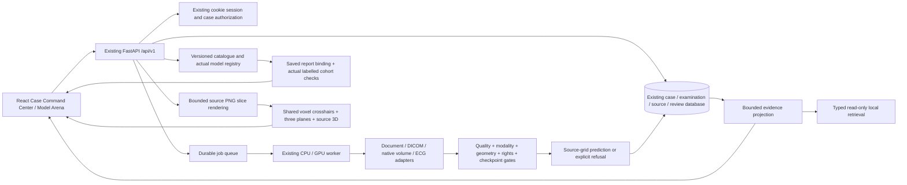
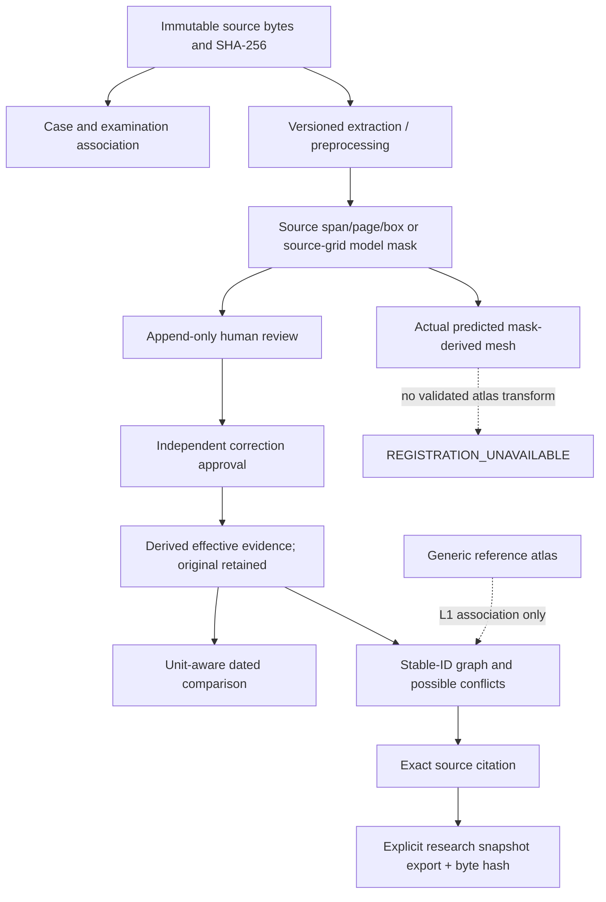

# Canonical architecture and evidence lineage

The graph is a reproducible projection of current persisted evidence, not a second clinical database or a causal disease model. It retains inactive/superseded evidence as history, excludes it from current claims, and bounds nodes/edges/reviews. All graph, source, copilot and spatial routes independently authorize case access. Catalogue data and saved public research evaluations contain no private-case evidence.

The viewer reuses existing decoders, PNG render endpoints, Three.js, mask editor and surfaces. This avoids installing a second DICOM engine without an established need. Source voxel planes are labelled as such, particularly for oblique inputs; they are not resampled patient-anatomical planes. Four-dimensional channel volumes are refused by this viewer, while their independently validated model adapter can run. No arbitrary channel flattening is introduced.
